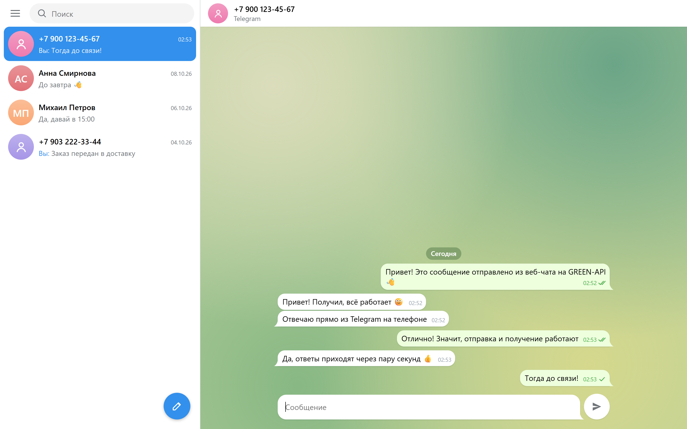
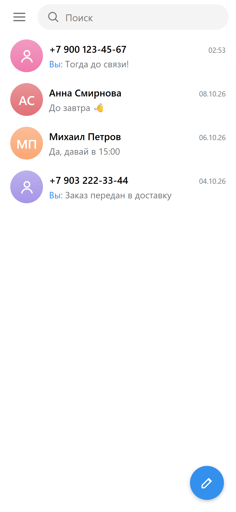
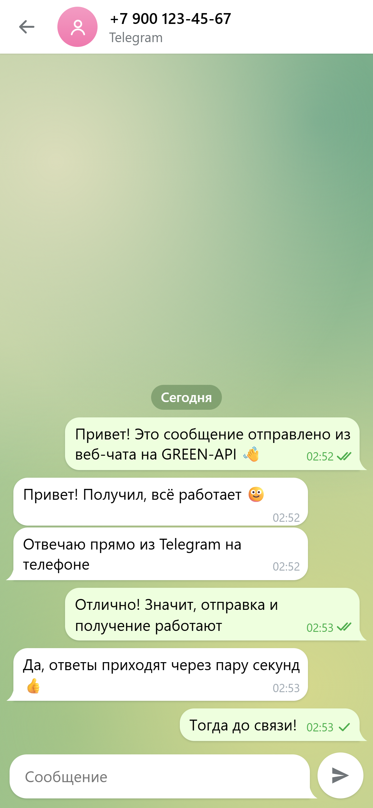

# Telegram-чат на GREEN-API

Тестовое задание на позицию «Фронтенд-разработчик React»: веб-интерфейс для отправки и получения
текстовых сообщений **Telegram** через [GREEN-API](https://green-api.com/telegram). Внешний вид повторяет
[Telegram Web](https://web.telegram.org/).



<p>
  
  
</p>

Остальные экраны — в папке [docs/screenshots](docs/screenshots).

## Возможности

- Вход по учётным данным инстанса GREEN-API (`idInstance`, `apiTokenInstance`, `apiUrl`) с проверкой
  состояния инстанса (`getStateInstance`).
- Создание чата по номеру телефона получателя (или по `@username`).
- Отправка текстовых сообщений — метод [`sendMessage`](https://green-api.com/telegram/docs/api/sending/SendMessage/).
- Получение входящих — [HTTP API](https://green-api.com/telegram/docs/api/receiving/technology-http-api/):
  цикл `receiveNotification` (long polling) → `deleteNotification`.
- Статусы исходящих (отправлено / доставлено / прочитано / ошибка), разделители дат, поиск по чатам.
- Адаптивная вёрстка: на телефоне список чатов и переписка открываются на отдельных экранах.
- История чатов хранится в `localStorage` браузера отдельно для каждого инстанса.

## Особенность Telegram

В отличие от WhatsApp, в Telegram `chatId` — это числовой идентификатор пользователя (например `10000000`),
а не номер телефона. Поэтому при создании чата номер сначала проверяется методом
[`checkAccount`](https://green-api.com/telegram/docs/api/service/CheckAccount/), который возвращает `chatId`.

## Запуск локально

Нужен Node.js 20+.

```bash
npm install
npm run dev
```

Откройте http://localhost:5173 и введите данные инстанса из [личного кабинета](https://console.green-api.com).

Другие команды:

```bash
npm test          # модульные тесты (Vitest)
npm run build     # production-сборка в dist/
npm run preview   # просмотр собранной версии
```

## Подготовка инстанса

1. Создайте Telegram-инстанс в [личном кабинете GREEN-API](https://console.green-api.com) и авторизуйте его.
2. Скопируйте `idInstance`, `apiTokenInstance` и `apiUrl`.
3. Для получения сообщений через HTTP API у инстанса должен быть **пустой** `webhookUrl` и включены входящие
   уведомления. Если это не так, приложение покажет предупреждение с кнопкой «Исправить» (вызывает `setSettings`).

## Сценарий проверки

1. Войти с данными инстанса.
2. Нажать на карандаш внизу списка чатов и ввести номер телефона получателя.
3. Написать сообщение и отправить (Enter, Shift+Enter — перенос строки).
4. Ответить на сообщение в Telegram — ответ появится в чате через пару секунд.

## Структура

Подробное описание работы со схемами — в [docs/ARCHITECTURE.md](docs/ARCHITECTURE.md).

```
src/
  api/greenApi.ts            клиент GREEN-API (fetch)
  hooks/useNotificationPolling.ts   цикл получения уведомлений
  hooks/useChats.ts          состояние чатов + отправка + сохранение в localStorage
  store/chatReducer.ts       редьюсер чатов и сообщений
  lib/notifications.ts       разбор уведомлений GREEN-API
  lib/contact.ts             разбор номера телефона / username
  components/                UI: вход, список чатов, новый чат, переписка, поле ввода
```

## Деплой

Workflow [`.github/workflows/deploy.yml`](.github/workflows/deploy.yml) при пуше в `main` прогоняет тесты, собирает
проект и публикует его на GitHub Pages (в настройках репозитория: *Settings → Pages → Source: GitHub Actions*).
Сборка использует относительные пути, поэтому `dist/` можно разместить на любом статическом хостинге.
