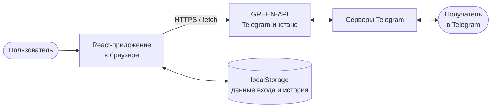
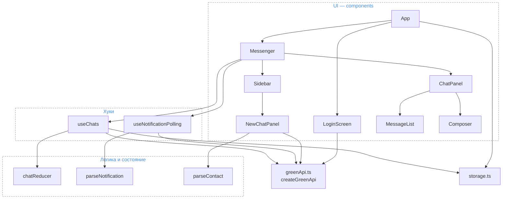
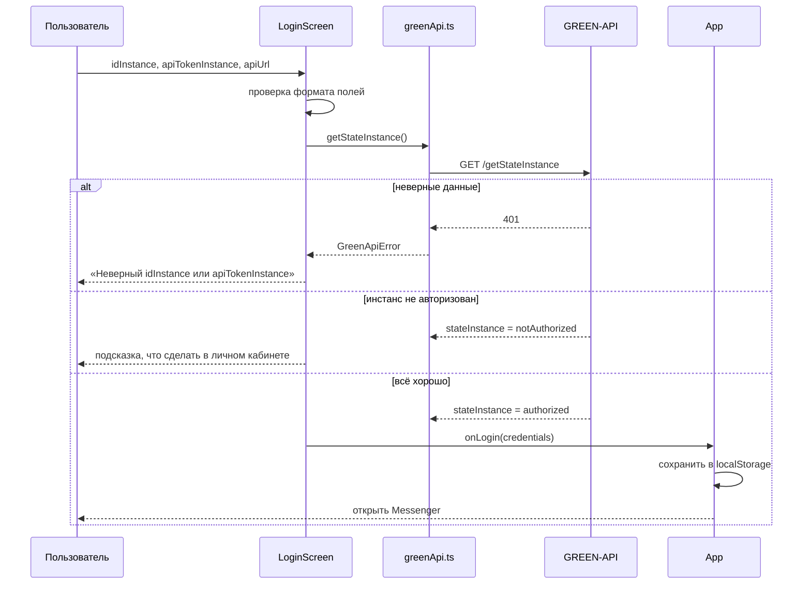
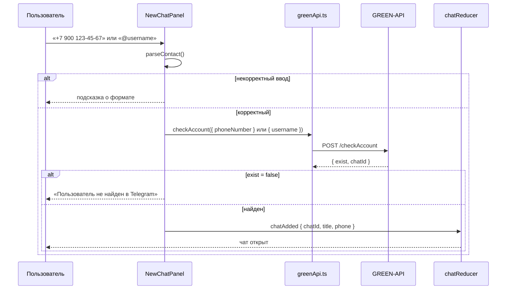
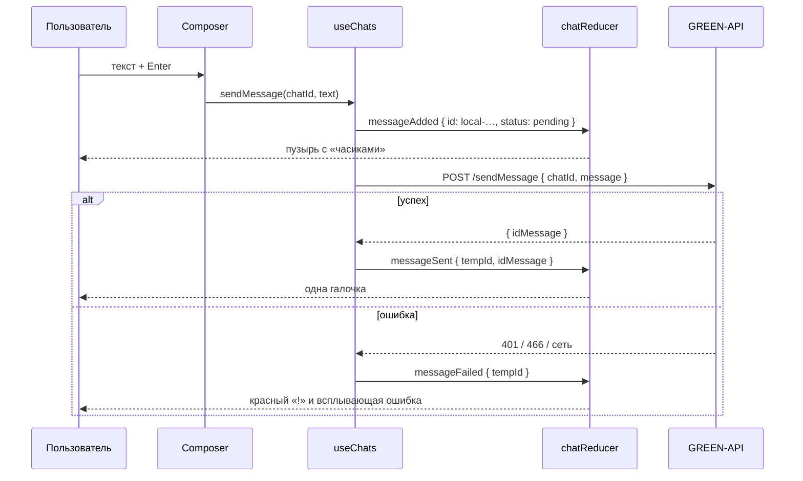
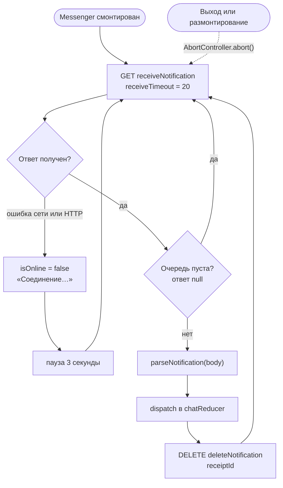
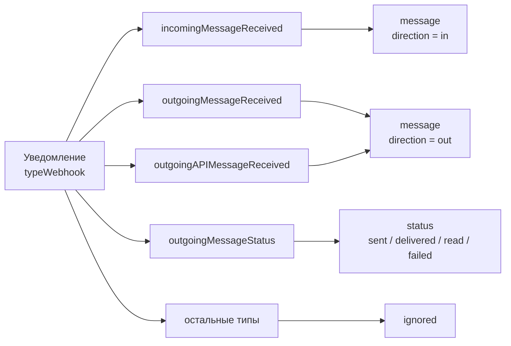
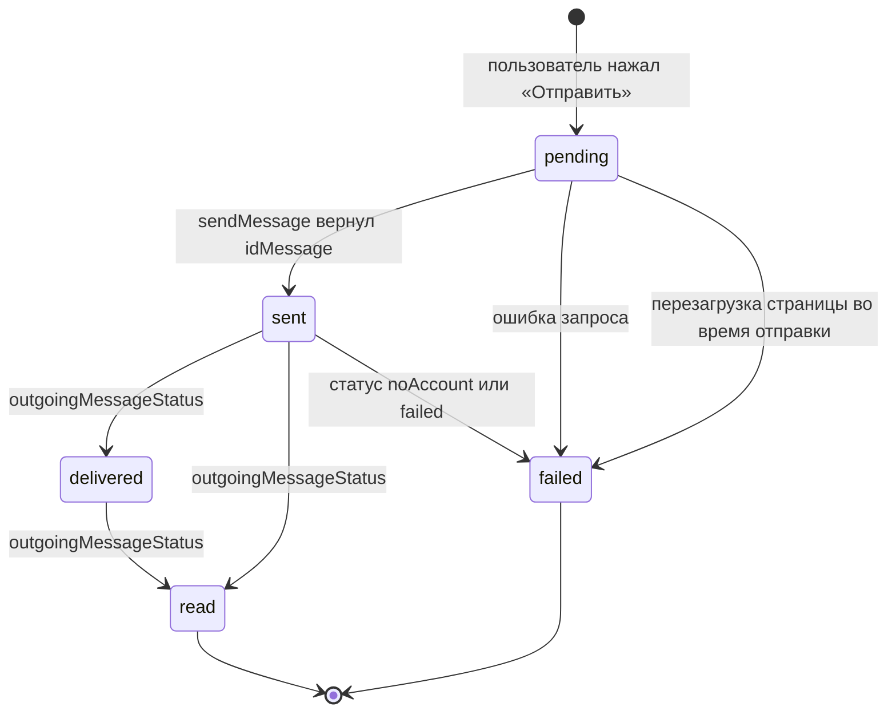
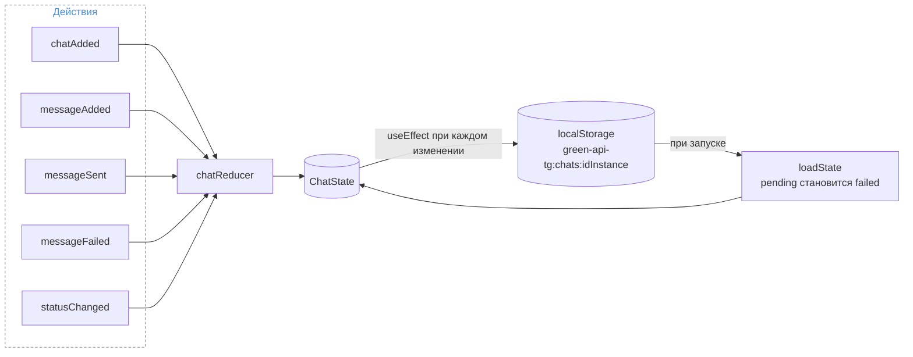
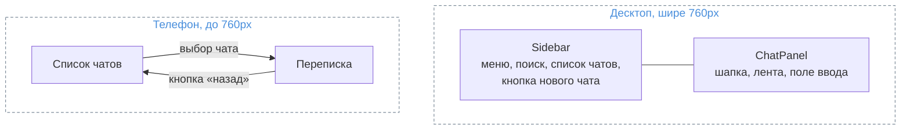

# Как устроено приложение

Это одностраничное React-приложение без собственного бэкенда: браузер обращается к REST API GREEN-API
напрямую, а GREEN-API уже работает с Telegram-аккаунтом, привязанным к инстансу.



## Слои

Код разделён на слои, каждый отвечает за своё:


| Слой           | Файлы                                                            | Что делает                                                                                                   |
| -------------------- | ----------------------------------------------------------------------- | ----------------------------------------------------------------------------------------------------------------------- |
| UI                 | `src/components/*`                                                    | Отрисовка экранов и обработка действий пользователя                     |
| Хуки           | `src/hooks/useChats.ts`, `src/hooks/useNotificationPolling.ts`        | Связывают UI с API: отправка, приём, сохранение                                      |
| Состояние | `src/store/chatReducer.ts`                                            | Чистый редьюсер: чаты, сообщения, статусы                                           |
| Логика       | `src/lib/notifications.ts`, `src/lib/contact.ts`, `src/lib/format.ts` | Чистые функции: разбор уведомлений, номеров, форматирование дат |
| API                | `src/api/greenApi.ts`                                                 | Тонкий клиент над`fetch`, перевод HTTP-ошибок в понятный текст              |
| Хранилище | `src/lib/storage.ts`                                                  | Безопасная обёртка над`localStorage`                                                              |



## Методы GREEN-API

Все запросы строятся по одному шаблону:

```
{apiUrl}/waInstance{idInstance}/{метод}/{apiTokenInstance}
```


| Метод            | HTTP   | Где используется                   | Зачем                                                                                             |
| ----------------------- | -------- | --------------------------------------------------- | -------------------------------------------------------------------------------------------------------- |
| `getStateInstance`    | GET    | `LoginScreen`                                     | Проверить данные входа и что инстанс авторизован в Telegram |
| `getSettings`         | GET    | `Messenger`                                       | Узнать, придут ли уведомления через HTTP API                             |
| `setSettings`         | POST   | `Messenger` (кнопка «Исправить») | Очистить`webhookUrl` и включить уведомления                                |
| `checkAccount`        | POST   | `NewChatPanel`                                    | Получить`chatId` по номеру телефона или `@username`                         |
| `sendMessage`         | POST   | `useChats`                                        | Отправить текстовое сообщение                                               |
| `receiveNotification` | GET    | `useNotificationPolling`                          | Забрать следующее уведомление из очереди                           |
| `deleteNotification`  | DELETE | `useNotificationPolling`                          | Подтвердить, что уведомление обработано                             |

Если HTTP-ответ не `ok`, клиент выбрасывает `GreenApiError` с текстом для пользователя: 401/403 —
неверные данные, 429 — слишком много запросов, 466 — исчерпан лимит тарифа и т. д.

## 1. Вход

Экран входа принимает `idInstance`, `apiTokenInstance` и `apiUrl`, проверяет их формат и делает пробный запрос
`getStateInstance`. Пускаем дальше, только если инстанс в состоянии `authorized`. Данные входа сохраняются в
`localStorage`, поэтому после перезагрузки страницы вход не нужен.



Сразу после входа `Messenger` вызывает `getSettings`. Если у инстанса задан `webhookUrl` или выключены входящие
уведомления, сообщения через HTTP API приходить не будут, поэтому показывается предупреждение с кнопкой
«Исправить», которая вызывает `setSettings`.

## 2. Создание чата

В Telegram `chatId` — числовой ID пользователя (`10000000`), а не номер телефона, как в WhatsApp. Поэтому
номер нужно сначала превратить в `chatId` методом `checkAccount`.

`parseContact` принимает номер в любом виде (`+7 (900) 123-45-67`, `89001234567`) и оставляет только цифры,
заменяя ведущую `8` на `7`. Строка, начинающаяся с `@`, считается username.



## 3. Отправка сообщения

Отправка «оптимистичная»: сообщение появляется в ленте сразу, с временным id и статусом «отправляется»,
не дожидаясь ответа сервера. Когда `sendMessage` вернёт настоящий `idMessage`, временный id заменяется
на него. По этому id потом сопоставляются уведомления о статусе (доставлено / прочитано).



**Гонка уведомления и ответа.** GREEN-API присылает уведомление `outgoingAPIMessageReceived` о каждом отправленном
через API сообщении. Если оно пришло раньше ответа `sendMessage`, в ленте уже есть сообщение с настоящим id.
Тогда редьюсер не переименовывает временное сообщение, а просто удаляет его, и дубля не появляется.

## 4. Получение сообщений

Используется технология HTTP API: уведомления копятся на стороне GREEN-API в очереди (FIFO, до 24 часов),
и приложение забирает их по одному. Цикл живёт в `useNotificationPolling`:

1. `receiveNotification?receiveTimeout=20` — long polling: запрос держится открытым до 20 секунд, пока не
   появится уведомление. Если очередь пуста, приходит `null`, и цикл просто повторяет запрос.
2. Тело уведомления разбирается функцией `parseNotification` и отправляется в редьюсер.
3. `deleteNotification/{receiptId}` — подтверждение. Без него сервер будет снова и снова отдавать то же
   уведомление. Вызывается в `finally`, чтобы ошибка разбора не застопорила очередь.
4. При сетевой ошибке индикатор в поиске меняется на «Соединение…», цикл ждёт 3 секунды и пробует снова.



Цикл привязан к объекту `api` и останавливается через `AbortController` при выходе из аккаунта или
размонтировании компонента — висящий long-polling запрос тоже отменяется. Колбэк хранится в `ref`, поэтому
перерисовки компонента не перезапускают цикл.

### Какие уведомления обрабатываются

`parseNotification` превращает «сырое» уведомление в одно из трёх событий:



- **incomingMessageReceived** — ответ собеседника. Если чата с ним ещё нет, он создаётся автоматически
  с именем из `senderData.chatName`.
- **outgoingMessageReceived** — сообщение, отправленное с телефона или из другого клиента Telegram; тоже
  показывается в ленте.
- **outgoingAPIMessageReceived** — эхо нашей же отправки через API; отбрасывается как дубль по `idMessage`.
- **outgoingMessageStatus** — смена статуса исходящего сообщения.

Текст достаётся из `textMessage` и `extendedTextMessage` (сообщения со ссылками и цитатами). Для фото,
стикеров и прочего показывается серая заглушка «Сообщение этого типа не поддерживается».

## 5. Жизненный цикл исходящего сообщения



Уведомления о статусах могут прийти не по порядку, поэтому `mergeStatus` разрешает переход только «вперёд»
по цепочке `pending → sent → delivered → read`: позднее пришедшее «доставлено» не откатит «прочитано».
Исключение — `failed`, он применяется всегда.

Отображение повторяет Telegram: «часики» — отправляется, одна галочка — отправлено или доставлено,
две галочки — прочитано, красный «!» — ошибка.

## 6. Состояние и хранение

Всё состояние чатов — один объект в `useReducer`:

```ts
interface ChatState {
  chats: Chat[];
  messages: Record<string, Message[]>;
}
```



- **messageAdded** — добавляет сообщение, пропускает дубли по `id`, сортирует по времени и при необходимости
  создаёт чат.
- **messageSent / messageFailed** — завершают оптимистичную отправку.
- **statusChanged** — ищет сообщение по `idMessage` во всех чатах и обновляет статус.

История хранится отдельно для каждого `idInstance`, так что при входе под другим инстансом чаты не смешиваются.
Обёртка `storage.ts` глушит ошибки `localStorage` (приватный режим, запрет хранилища) — приложение продолжает
работать, просто без сохранения истории.

## 7. Интерфейс



Внешний вид повторяет Telegram Web:

- фон чата — градиент в цветах стандартной темы;
- исходящие пузыри зелёные справа, входящие белые слева;
- «хвостик» рисуется только у последнего сообщения в группе подряд идущих от одного отправителя;
- дата закрепляется сверху при прокрутке («Сегодня», «Вчера», «5 октября»);
- лента автоматически прокручивается вниз при новом сообщении;
- поле ввода растёт вместе с текстом: Enter — отправить, Shift+Enter — новая строка, лимит 4096 символов
  (ограничение `sendMessage`);
- чаты в списке отсортированы по времени последнего сообщения, работает поиск по имени и номеру.

## Тесты

Покрыта чистая логика, где чаще всего прячутся ошибки (`npm test`, Vitest):

- `notifications.test.ts` — разбор всех типов уведомлений, нетекстовых сообщений, статусов и мусорного ввода;
- `contact.test.ts` — разные форматы номеров, username, отказ на некорректном вводе;
- `chatReducer.test.ts` — автосоздание чата, защита от дублей, замена временного id, гонка уведомления
  и ответа, запрет отката статуса.
